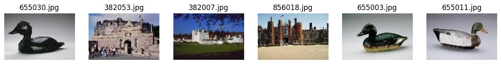
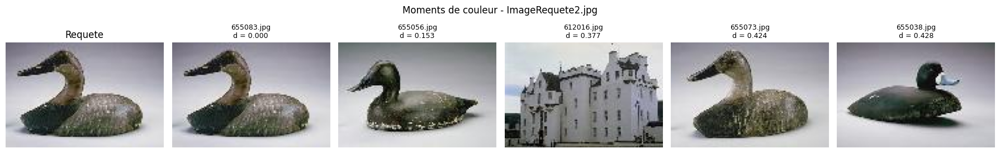
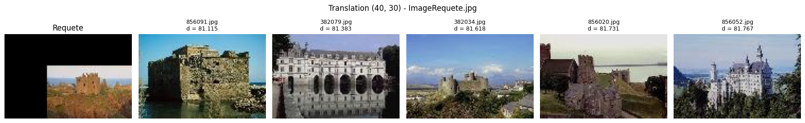
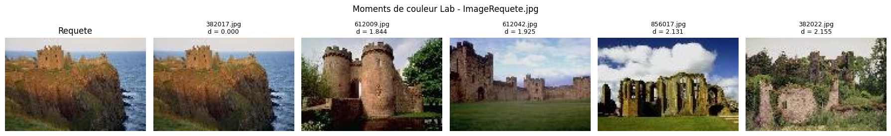
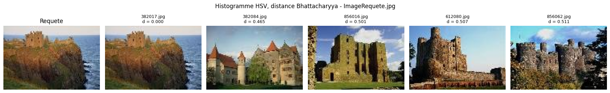
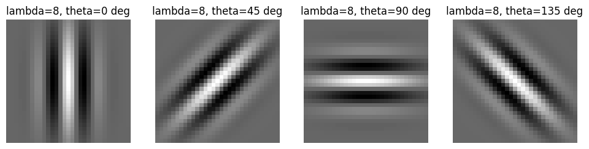
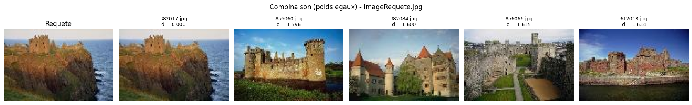

# Content-Based Image Retrieval (CBIR)

Moteur de recherche d'images par le contenu, construit avec des **descripteurs visuels classiques** (couleur, texture, forme) puis amélioré étape par étape : espaces couleur, distances adaptées aux histogrammes, filtres de Gabor, fusion pondérée des descripteurs et interface de recherche interactive.

> Python · OpenCV · scikit-image · NumPy · Matplotlib · ipywidgets · Kaggle

---

## Principe

Un système CBIR retrouve les images les plus ressemblantes à une image requête **sans utiliser de mots-clés**, uniquement à partir de leur contenu visuel.

1. **Indexation** : chaque image de la base est décrite par un vecteur de caractéristiques (couleur, texture, forme), stocké dans une matrice d'index.
2. **Recherche** : on calcule le même vecteur pour l'image requête, on mesure sa distance avec chaque image de la base, puis on affiche les **5 images les plus proches**.

```
Image requête ──► Extraction des descripteurs ──► Calcul des distances ──► Tri ──► Top 5
                                                        ▲
Base d'images ──► Extraction des descripteurs ──► Matrice d'index
```

## Données

Sous-ensemble de la base **COREL** : **270 images** réparties en deux groupes (châteaux et canards en bois), et deux images requêtes.




---

## TP1 : approche classique avec des descripteurs globaux

📓 [`TP1/TP1_CBIR_descripteurs_globaux.ipynb`](TP1/TP1_CBIR_descripteurs_globaux.ipynb)

Les descripteurs sont ajoutés un par un, en analysant l'effet de chacun sur les résultats.

| Étape | Descripteur | Taille du vecteur |
|---|---|---|
| 1 | Comparaison pixel à pixel (distance euclidienne) | 128 × 128 × 3 |
| 2 | Moments de couleur RGB (moyenne, variance) | 6 |
| 3 | + Histogramme HSV quantifié (8 × 4 × 4) | 134 |
| 4 | + Texture GLCM (contraste, corrélation, énergie, homogénéité) | 138 |
| 5 | + Forme HOG (cellules 8 × 8, 8 orientations) | 1 706 |

**Moments de couleur seuls** : rapides mais peu discriminants. Un château blanc apparaît parmi les canards, car ses couleurs grises ressemblent au fond de la requête.



**Ajout de l'histogramme HSV** : le château disparaît, les 5 résultats sont des canards.


**Ajout du HOG** : les résultats sont dominés par la forme. On retrouve des canards de même silhouette et de même orientation, même avec des couleurs différentes.


### Robustesse aux transformations géométriques

| Transformation | Résultat |
|---|---|
| Changement d'échelle | Très robuste : l'image d'origine reste en 1re position |
| Translation | Dégradation : la bande noire modifie les couleurs et les contours |
| Rotation | Pire cas : le HOG, qui domine le vecteur, n'est pas invariant à la rotation |




---

## TP2 : amélioration du moteur de recherche

📓 [`TP2/TP2_CBIR_amelioration.ipynb`](TP2/TP2_CBIR_amelioration.ipynb)

### 1. Espaces de représentation de la couleur

Comparaison des moments de couleur en **RGB**, **HSV** et **Lab**. Lab, presque uniforme pour la perception humaine, retourne des châteaux aux couleurs plus proches de la requête.



### 2. Distances adaptées aux histogrammes

Comparaison de la distance **euclidienne** avec l'**intersection d'histogrammes**, le **Khi-deux** et **Bhattacharyya**. Ces trois dernières tiennent compte de la nature des distributions et donnent un classement plus pertinent.



### 3. Texture de Gabor

Banque de **12 filtres de Gabor** (3 longueurs d'onde × 4 orientations), soit un vecteur de 24 valeurs (énergie moyenne et variance de chaque réponse). Gabor donne une description plus riche, sur plusieurs échelles et orientations, que la GLCM du TP1 (4 valeurs).




### 4. Forme : histogramme des orientations des contours (EOH)

Gradients de Sobel, seuillage des contours, 4 orientations et 16 blocs, soit **64 valeurs**. Les résultats sont comparables au HOG pour un vecteur environ **25 fois plus petit**, donc une recherche plus rapide.


### 5. Fusion pondérée des descripteurs

Au TP1, la simple concaténation laissait le HOG (1 568 valeurs) écraser les autres descripteurs. Ici, on calcule une distance par descripteur, on la normalise entre 0 et 1, puis on fait une somme pondérée :

```
D = w1·d_couleur + w2·d_histogramme + w3·d_texture + w4·d_forme
```

Aucun descripteur ne domine, et les images retrouvées ressemblent à la requête à la fois en couleur et en forme.




### 6. Interface graphique

Interface interactive avec **ipywidgets** :
- choix d'une image requête, ou chargement d'une image depuis l'ordinateur ;
- réglage du poids de chaque descripteur ;
- affichage des 5 images les plus similaires.

---

## Conclusions

- **HSV et Lab** donnent des couleurs plus proches de la requête que RGB.
- **Intersection, Khi-deux et Bhattacharyya** sont mieux adaptées aux histogrammes que la distance euclidienne.
- **Gabor** décrit mieux la texture que la GLCM.
- **EOH** offre un bon compromis entre précision et rapidité par rapport au HOG.
- La **fusion pondérée et normalisée** équilibre les descripteurs et permet d'adapter la recherche au besoin de l'utilisateur.
- **Limites** : la rotation et le fossé sémantique. Des descripteurs de bas niveau ne suffisent pas toujours à retrouver des images qui ont le même sens. Une piste d'amélioration naturelle est l'usage de descripteurs appris par deep learning (CNN, CLIP).

## Lancer le projet

```bash
pip install opencv-python scikit-image numpy matplotlib ipywidgets
```

Les notebooks ont été exécutés sur **Kaggle**. Pour les lancer en local, place la base dans un dossier contenant `obj_decoys/` (images de la base) et `img_requetes/` (images requêtes), puis adapte le chemin dans la cellule de chargement.

## Structure

```
├── TP1/
│   └── TP1_CBIR_descripteurs_globaux.ipynb
├── TP2/
│   └── TP2_CBIR_amelioration.ipynb
├── images/
└── README.md
```

## Auteure

**Meriem Melki**, élève ingénieure à l'INSAT (Institut National des Sciences Appliquées et de Technologie)
[LinkedIn](https://linkedin.com/in/meriem-melki) · [GitHub](https://github.com/MelkiMeriem)
