# Content-Based Image Retrieval (CBIR)

Moteur de recherche d'images par le contenu, construit en trois étapes : des **descripteurs visuels classiques** (couleur, texture, forme), puis leur **amélioration** (espaces couleur, distances adaptées, Gabor, fusion pondérée), et enfin des **descripteurs appris par deep learning** (CNN pré-entraîné VGG16 et autoencodeur).

> Python · OpenCV · scikit-image · TensorFlow / Keras · NumPy · Matplotlib · ipywidgets · Kaggle

---

## Principe

Un système CBIR retrouve les images les plus ressemblantes à une image requête **sans utiliser de mots-clés**, uniquement à partir de leur contenu visuel.

1. **Indexation** : chaque image de la base est décrite par un vecteur de caractéristiques, stocké dans une matrice d'index.
2. **Recherche** : on calcule le même vecteur pour l'image requête, on mesure sa distance avec chaque image de la base, puis on affiche les **5 images les plus proches**.

```
Image requête ──► Extraction des descripteurs ──► Calcul des distances ──► Tri ──► Top 5
                                                        ▲
Base d'images ──► Extraction des descripteurs ──► Matrice d'index
```

Les trois parties du projet changent uniquement la façon de calculer les descripteurs.

| Partie | Descripteurs | Base |
|---|---|---|
| [1. Descripteurs globaux](#1-descripteurs-globaux-classiques) | Couleur, histogramme, texture GLCM, forme HOG | COREL, 270 images, 2 groupes |
| [2. Amélioration des descripteurs](#2-amélioration-des-descripteurs) | HSV / Lab, distances d'histogrammes, Gabor, EOH, fusion pondérée | COREL, 270 images, 2 groupes |
| [3. Descripteurs deep learning](#3-descripteurs-deep-learning) | VGG16 pré-entraîné, autoencodeur convolutif | COREL, 1000 images, 10 classes |

---

## 1. Descripteurs globaux classiques

Notebook : [`01-descripteurs-globaux/cbir_descripteurs_globaux.ipynb`](01-descripteurs-globaux/cbir_descripteurs_globaux.ipynb)

### Données

Sous-ensemble de la base **COREL** : **270 images** réparties en deux groupes (châteaux et canards en bois), et deux images requêtes.


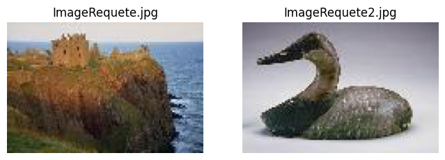

### Démarche

Les descripteurs sont ajoutés un par un, en analysant l'effet de chacun sur les résultats.

| Étape | Descripteur | Taille du vecteur |
|---|---|---|
| 1 | Comparaison pixel à pixel (distance euclidienne) | 128 × 128 × 3 |
| 2 | Moments de couleur RGB (moyenne, variance) | 6 |
| 3 | + Histogramme HSV quantifié (8 × 4 × 4) | 134 |
| 4 | + Texture GLCM (contraste, corrélation, énergie, homogénéité) | 138 |
| 5 | + Forme HOG (cellules 8 × 8, 8 orientations) | 1 706 |

**Moments de couleur seuls** : rapides mais peu discriminants. Un château blanc apparaît parmi les canards, car ses couleurs grises ressemblent au fond de la requête.


**Ajout de l'histogramme HSV** : le château disparaît, les 5 résultats sont des canards.

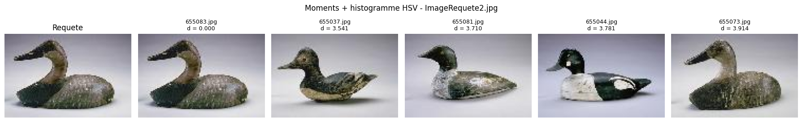

**Ajout du HOG** : les résultats sont dominés par la forme. On retrouve des canards de même silhouette et de même orientation, même avec des couleurs différentes.

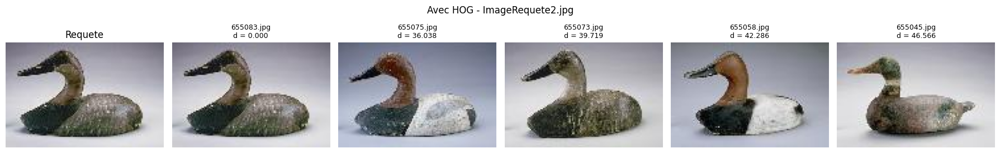

### Robustesse aux transformations géométriques

| Transformation | Résultat |
|---|---|
| Changement d'échelle | Très robuste : l'image d'origine reste en 1re position |
| Translation | Dégradation : la bande noire modifie les couleurs et les contours |
| Rotation | Pire cas : le HOG, qui domine le vecteur, n'est pas invariant à la rotation |


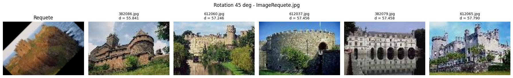

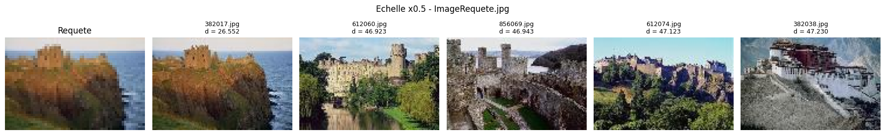

---

## 2. Amélioration des descripteurs

Notebook : [`02-amelioration-descripteurs/cbir_amelioration_descripteurs.ipynb`](02-amelioration-descripteurs/cbir_amelioration_descripteurs.ipynb)

Même base que la partie 1.

### Espaces de représentation de la couleur

Comparaison des moments de couleur en **RGB**, **HSV** et **Lab**. Lab, presque uniforme pour la perception humaine, retourne des châteaux aux couleurs plus proches de la requête.


### Distances adaptées aux histogrammes

Comparaison de la distance **euclidienne** avec l'**intersection d'histogrammes**, le **Khi-deux** et **Bhattacharyya**. Ces trois dernières tiennent compte de la nature des distributions et donnent un classement plus pertinent.


### Texture de Gabor

Banque de **12 filtres de Gabor** (3 longueurs d'onde × 4 orientations), soit un vecteur de 24 valeurs (énergie moyenne et variance de chaque réponse). Gabor donne une description plus riche, sur plusieurs échelles et orientations, que la GLCM (4 valeurs).


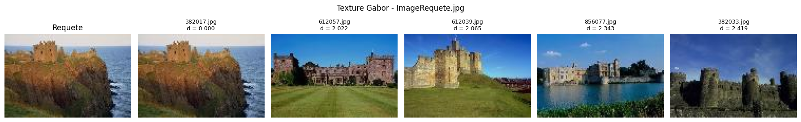

### Forme : histogramme des orientations des contours (EOH)

Gradients de Sobel, seuillage des contours, 4 orientations et 16 blocs, soit **64 valeurs**. Les résultats sont comparables au HOG pour un vecteur environ **25 fois plus petit**, donc une recherche plus rapide.

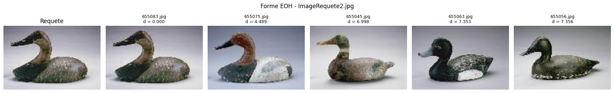

### Fusion pondérée des descripteurs

Dans la partie 1, la simple concaténation laissait le HOG (1 568 valeurs) écraser les autres descripteurs. Ici, on calcule une distance par descripteur, on la normalise entre 0 et 1, puis on fait une somme pondérée :

```
D = w1·d_couleur + w2·d_histogramme + w3·d_texture + w4·d_forme
```

Aucun descripteur ne domine, et les images retrouvées ressemblent à la requête à la fois en couleur et en forme.


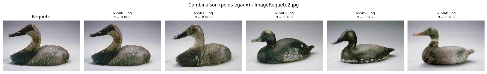

### Interface graphique

Interface interactive avec **ipywidgets** :
- choix d'une image requête, ou chargement d'une image depuis l'ordinateur ;
- réglage du poids de chaque descripteur ;
- affichage des 5 images les plus similaires.

---

## 3. Descripteurs deep learning

Notebook : [`03-deep-learning/cbir_deep_vgg16_autoencodeur.ipynb`](03-deep-learning/cbir_deep_vgg16_autoencodeur.ipynb)

### Données

Base **COREL** de **10 classes** (plages, bus, dinosaures, éléphants, fleurs, nourriture, chevaux, monuments, montagnes, villages africains) : **900 images** d'entraînement qui forment la base de recherche, et **100 images** de test utilisées comme requêtes.

### CNN pré-entraîné : VGG16

VGG16 entraîné sur ImageNet est utilisé comme extracteur de descripteurs, sans réentraînement (`include_top=False`, `trainable=False`). Un Global Average Pooling sur le dernier bloc donne un vecteur de **512 valeurs** par image.

Les feature maps montrent la hiérarchie des représentations : contours et couleurs au début du réseau, textures au milieu, parties d'objets à la fin.

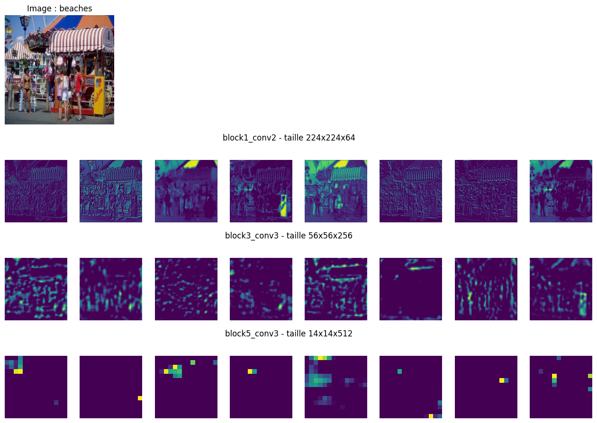

### Autoencodeur convolutif

- **Encodeur** : 3 blocs Conv2D + MaxPooling (128 → 16), Flatten, Dense(256).
- **Décodeur** : Dense, Reshape, 3 Conv2DTranspose (16 → 128).

Il est entraîné à reconstruire ses images d'entrée (MSE), sans étiquettes. Le code latent de **256 valeurs** sert ensuite de descripteur. L'erreur de validation se stabilise vers l'époque 12 alors que l'erreur d'entraînement continue de baisser : le modèle fait du surapprentissage sur les 900 images.

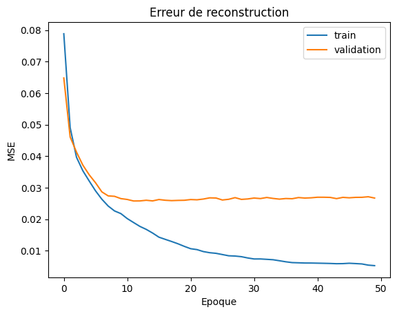

Les reconstructions sont floues : le code latent garde les couleurs et leur répartition, mais pas les objets.

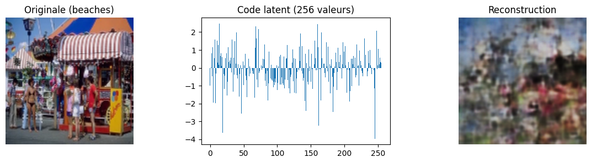

### Résultats

Précision@5 moyenne sur les 100 requêtes (proportion des 5 images retrouvées qui sont de la même classe que la requête) :

| Descripteur | Similarité cosinus | Distance euclidienne |
|---|---|---|
| CNN VGG16 | **0.96** | 0.92 |
| Autoencodeur | 0.57 | 0.46 |

Le CNN retrouve presque toujours la bonne classe, car ses descripteurs contiennent une information sémantique apprise sur ImageNet. L'autoencodeur se trompe dès que deux classes ont des couleurs proches, par exemple une montagne verte retrouvée pour une requête d'éléphant (en rouge ci-dessous). La similarité cosinus est meilleure que la distance euclidienne pour les deux descripteurs.

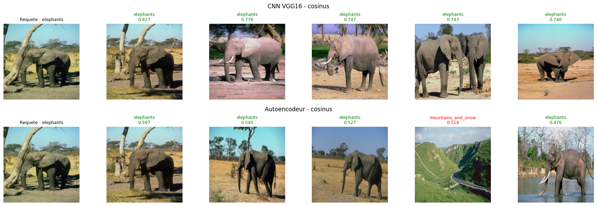

---

## Conclusions

- **HSV et Lab** donnent des couleurs plus proches de la requête que RGB.
- **Intersection, Khi-deux et Bhattacharyya** sont mieux adaptées aux histogrammes que la distance euclidienne.
- **Gabor** décrit mieux la texture que la GLCM, et **EOH** offre un bon compromis entre précision et rapidité par rapport au HOG.
- La **fusion pondérée et normalisée** équilibre les descripteurs classiques.
- Les descripteurs classiques restent sensibles à la rotation et limités par le **fossé sémantique**.
- Un **CNN pré-entraîné** réduit ce fossé : 0.96 de précision@5 sans aucun entraînement. L'**autoencodeur**, entraîné sur peu d'images, reste proche d'un descripteur de couleur.

## Lancer le projet

```bash
pip install opencv-python scikit-image numpy matplotlib ipywidgets tensorflow
```

Les notebooks ont été exécutés sur **Kaggle**. Le code cherche automatiquement les dossiers de la base dans `/kaggle/input` :
- parties 1 et 2 : `obj_decoys/` (images de la base) et `img_requetes/` (images requêtes) ;
- partie 3 : `training_set/` et `test_set/`, avec un sous-dossier par classe.

Pour les lancer en local, il faut adapter le chemin dans la cellule de chargement. La partie 3 a besoin d'Internet pour télécharger les poids de VGG16, et un GPU accélère l'entraînement de l'autoencodeur.

## Structure

```
├── 01-descripteurs-globaux/
│   └── cbir_descripteurs_globaux.ipynb
├── 02-amelioration-descripteurs/
│   └── cbir_amelioration_descripteurs.ipynb
├── 03-deep-learning/
│   └── cbir_deep_vgg16_autoencodeur.ipynb
├── images/
└── README.md
```

## Auteure

**Meriem Melki**, élève ingénieure à l'INSAT (Institut National des Sciences Appliquées et de Technologie)
[LinkedIn](https://linkedin.com/in/meriem-melki) · [GitHub](https://github.com/MelkiMeriem)
